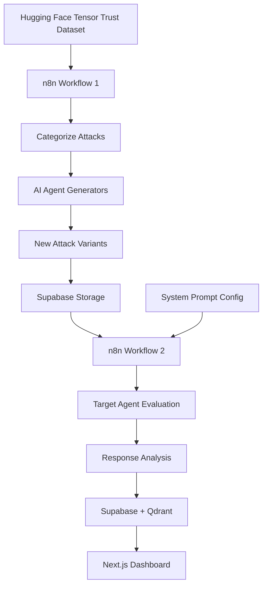

# Rainforce

Rainforce is an automated red-teaming and evaluation platform for AI agents that generates, executes, and analyzes prompt injection attacks. Built by a team for the n8n "Agents in the Loop" hackathon, this project won 1st place.

This is Amy Wang's fork of the original team repository [georgeIshaq/Rainforce](https://github.com/georgeIshaq/Rainforce).

## Overview

Rainforce uses n8n workflows to pull real-world prompt injection attacks from the Tensor Trust dataset on Hugging Face, categorizes them by attack type (instruction injection, role manipulation, output extraction, boundary breaking, and social engineering), and uses AI agents to generate novel variations. These attacks are then executed against a target AI agent with a configurable system prompt. The results, including agent responses and automated evaluations, are stored in Supabase and Qdrant for analysis. A Next.js dashboard provides visualization of attack patterns, success rates, agent responses, and evaluation metrics.



## Features

- **Attack Generation**: Automatically pulls and categorizes prompt injection attacks from Tensor Trust dataset
- **AI-Powered Variants**: Uses GPT-4 to generate new attack variations across 5 categories
- **Automated Testing**: Runs attacks against configurable target agents and evaluates responses
- **Evaluation System**: AI-powered evaluation determines if attacks succeeded or were properly defended against
- **Vector Search**: Stores attack patterns in Qdrant for semantic search and similarity analysis
- **Real-time Dashboard**: Interactive Next.js frontend with charts, tables, and filtering
- **System Prompt Testing**: Test different defensive system prompts against the attack library

## Tech Stack

- **Workflow Automation**: n8n (with Docker)
- **AI Models**: OpenAI GPT-4.1-mini and GPT-3.5-turbo
- **Storage**: Supabase (PostgreSQL), Qdrant (vector database)
- **Frontend**: Next.js 15, React 19, TypeScript, Tailwind CSS
- **Visualization**: Recharts
- **UI Components**: Radix UI, shadcn/ui
- **Local LLM (optional)**: Ollama with Llama 3.2

## Setup

### Prerequisites

- Docker and Docker Compose
- Node.js 20+ (for frontend development)
- OpenAI API key
- Supabase project

### 1. Clone the Repository

```bash
git clone https://github.com/amywangg/Rainforce.git
cd Rainforce
```

### 2. Configure Environment Variables

Copy the example environment file and fill in your credentials:

```bash
cp .env.example .env
```

Edit `.env` and set:
- `N8N_ENCRYPTION_KEY` (generate a secure key)
- `N8N_USER_MANAGEMENT_JWT_SECRET` (generate a secure key)
- `POSTGRES_USER`, `POSTGRES_PASSWORD`, `POSTGRES_DB` (for n8n database)

For Mac users running Ollama locally, uncomment and configure `OLLAMA_HOST`.

### 3. Start n8n and Services

```bash
docker compose up
```

This starts:
- PostgreSQL (n8n database)
- n8n (workflow automation, accessible at http://localhost:5678)
- Qdrant (vector database, accessible at http://localhost:6333)
- Ollama (optional, for local LLM)

The n8n workflows and credentials from `n8n/demo-data` are automatically imported.

### 4. Configure n8n Credentials

After n8n starts, open http://localhost:5678 and configure:
- **OpenAI API**: Add your OpenAI API key
- **Supabase API**: Add your Supabase URL and API key

The demo credentials are encrypted placeholders and need to be replaced with your actual credentials.

### 5. Set Up Supabase Database

Create the following tables in your Supabase project:

**attack_patterns**
```sql
CREATE TABLE attack_patterns (
  id BIGSERIAL PRIMARY KEY,
  attack_data JSONB,
  vector_size INTEGER,
  created_at TIMESTAMP WITH TIME ZONE DEFAULT NOW()
);
```

**system_prompts**
```sql
CREATE TABLE system_prompts (
  id BIGSERIAL PRIMARY KEY,
  system_prompt TEXT,
  created_at TIMESTAMP WITH TIME ZONE DEFAULT NOW()
);
```

**agent_responses**
```sql
CREATE TABLE agent_responses (
  id BIGSERIAL PRIMARY KEY,
  agent_prompt TEXT,
  attack TEXT,
  agent_response TEXT,
  evaluation TEXT,
  recommendation TEXT,
  created_at TIMESTAMP WITH TIME ZONE DEFAULT NOW()
);
```

### 6. Run the Frontend

```bash
cd frontend
npm install
```

Create `frontend/.env.local` with your credentials:

```bash
NEXT_PUBLIC_SUPABASE_URL=your_supabase_url
NEXT_PUBLIC_SUPABASE_ANON_KEY=your_supabase_anon_key
NEXT_PUBLIC_QDRANT_URL=http://localhost:6333
```

Start the development server:

```bash
npm run dev
```

The dashboard will be available at http://localhost:3000.

### 7. Run Workflows

In the n8n interface (http://localhost:5678):

1. **Workflow 1** (My workflow): Fetches Tensor Trust attacks, categorizes them, generates new variants using AI, and stores them in Supabase
2. **Workflow 2** (My workflow 2): Retrieves attack patterns, runs them against a target agent with a configured system prompt, evaluates responses, and stores results

## Repository Structure

```
.
├── n8n/
│   └── demo-data/
│       ├── credentials/       # n8n credential files (encrypted)
│       └── workflows/         # Pre-configured n8n workflows
├── frontend/
│   ├── src/
│   │   ├── app/              # Next.js app router pages
│   │   ├── components/       # React components (dashboard, tables)
│   │   ├── hooks/            # Custom React hooks for data fetching
│   │   └── lib/              # Utilities (Supabase, Qdrant clients)
│   ├── public/               # Static assets
│   └── package.json
├── docker-compose.yml        # Docker services configuration
├── .env.example              # Environment variables template
└── README.md
```

## Usage

1. Configure a system prompt in the frontend's "System Prompt Area"
2. Run Workflow 1 in n8n to generate attack patterns
3. Run Workflow 2 in n8n to test those attacks against your configured system prompt
4. View results in the frontend dashboard at http://localhost:3000

The dashboard shows:
- **Attack Patterns Table**: Browse and search generated attacks by category and technique
- **Agent Responses Table**: View how the target agent responded to each attack
- **Evaluation Dashboard**: Charts showing pass/fail rates, recommendations, and response statistics
- **System Prompt Manager**: Manage and version different defensive system prompts

## Team

<!-- Add team member names and roles here -->

## License

This project is licensed under the MIT License. See the [LICENSE](LICENSE) file for details.

## Acknowledgments

- Built for the n8n "Agents in the Loop" hackathon (1st place winner)
- Uses the [Tensor Trust](https://huggingface.co/datasets/qxcv/tensor-trust) prompt injection dataset
- Original repository: [georgeIshaq/Rainforce](https://github.com/georgeIshaq/Rainforce)
